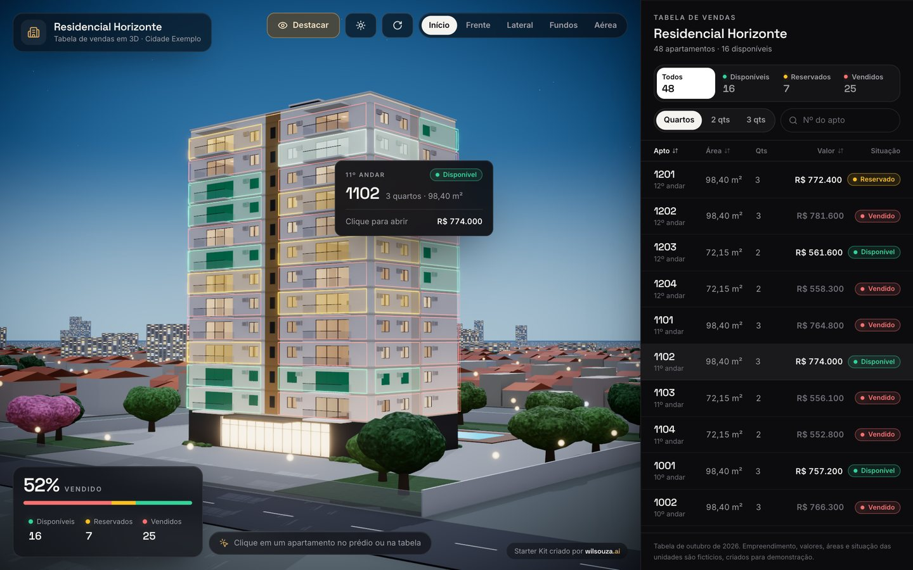
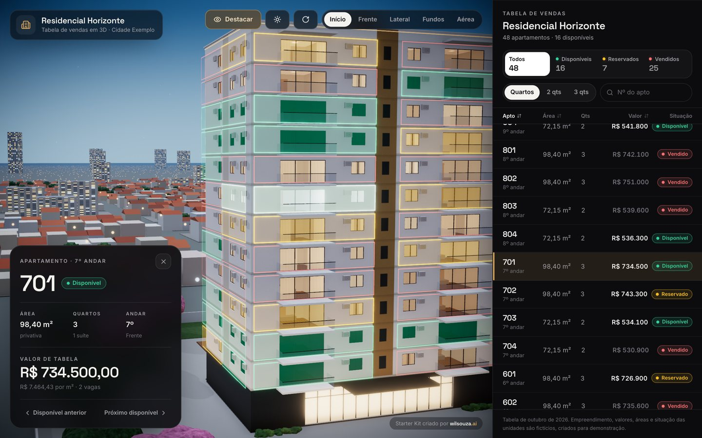
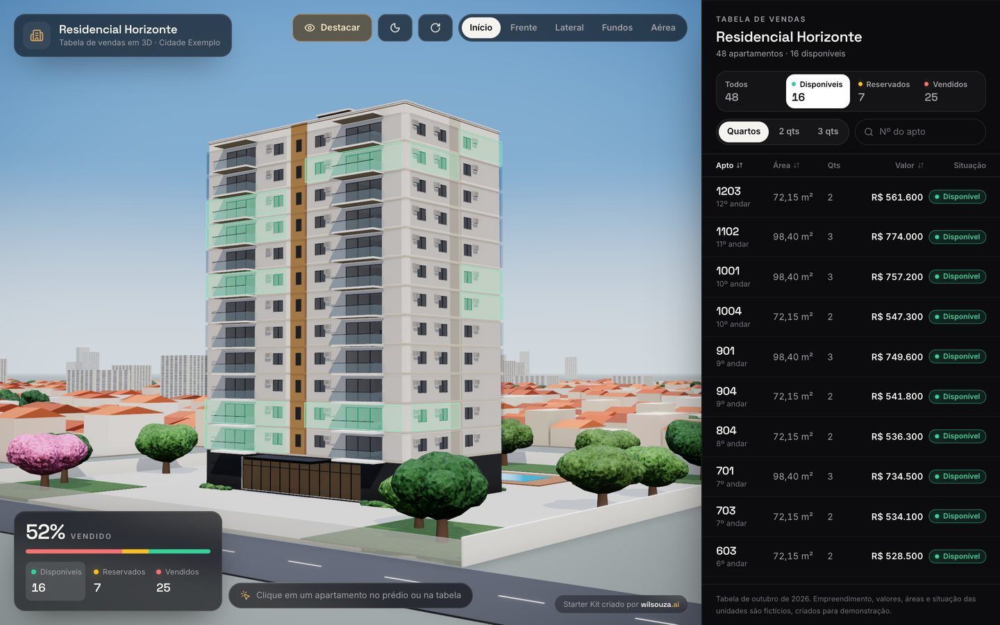
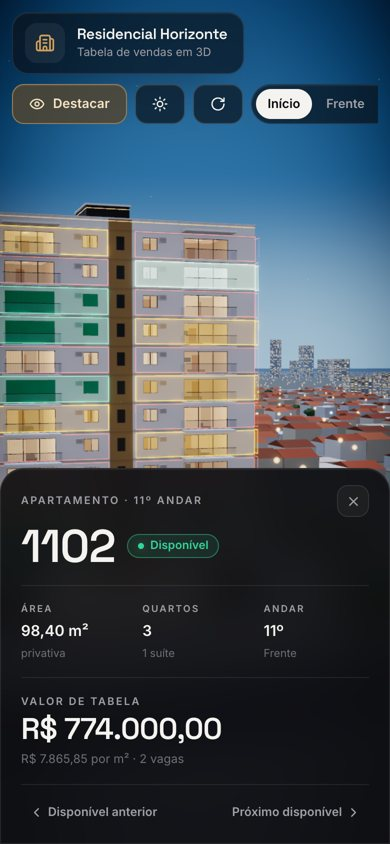

# Tabela Imobiliária 3D · Starter Kit

**Criado por [WilSouza.ai](https://wilsouza.com)** · **[Ver a demonstração online](https://tabela3d.wilsouza.com)** · **[Página do kit](https://kit.wilsouza.com)**

Uma tabela de vendas imobiliária em que o prédio é a interface. Você gira o edifício em 3D, vê na fachada quais apartamentos estão disponíveis, reservados ou vendidos, clica em uma unidade e a tabela ao lado acompanha. É um projeto real, com código aberto, feito com inteligência artificial (Claude Code) para você estudar, rodar no seu computador e modificar, mesmo sem saber programar.



> Todos os dados deste projeto são **fictícios**: o "Residencial Horizonte", a "Construtora Exemplo", os valores, as áreas e a situação das unidades foram criados só para demonstração.

## O que ele faz

- Prédio 3D de demonstração com 12 andares e 48 apartamentos, desenhado por código (sem arquivo 3D externo).
- Cada apartamento tem número, andar, área, quartos, suítes, vagas, valor e situação.
- Situações **disponível**, **reservado** e **vendido**, com destaque colorido na fachada.
- À noite, as janelas dos vendidos ficam acesas e as dos disponíveis apagadas.
- Clique no apartamento direto no prédio: a câmera voa até ele e aparece o cartão com os dados.
- Tabela lateral com todas as unidades, filtros por situação e por quartos, busca pelo número e ordenação.
- Prédio e tabela sincronizados: passar o mouse na linha acende o apartamento no 3D, e o que você seleciona no prédio fica marcado na tabela.
- Vistas prontas (início, frente, lateral, fundos, aérea), modo dia e noite e giro automático.
- Funciona no computador e no celular.
- Roda 100% no seu computador: sem banco de dados, sem login, sem chave de API e sem serviço pago.

| Apartamento selecionado | Filtro de disponíveis, de dia | Celular |
|---|---|---|
|  |  |  |

## Comece por aqui

Nunca programou? Siga o **[TUTORIAL.md](TUTORIAL.md)**. Ele explica, passo a passo, como instalar as ferramentas, baixar este projeto, abrir no Claude Code e fazer as primeiras mudanças conversando com a IA.

Depois, copie o prompt do **[PROMPT-CLAUDE.md](PROMPT-CLAUDE.md)** e cole no Claude Code. Ele faz a IA analisar o projeto, explicar a estrutura em linguagem simples e te ajudar a personalizar.

## Instalação rápida (para quem já usa o terminal)

Você precisa do [Node.js](https://nodejs.org) versão 20.19 ou mais nova (recomendado: a versão LTS).

```bash
npm install
npm run dev
```

Abra **http://localhost:6240** no navegador.

Outros comandos:

| Comando | O que faz |
|---|---|
| `npm run dev` | Abre o sistema no seu computador, atualizando a cada arquivo salvo |
| `npm run build` | Gera a versão pronta para publicar, na pasta `dist/` |
| `npm run preview` | Mostra a versão de `dist/` no endereço http://localhost:6241 |
| `npm run typecheck` | Confere se o código não tem erros de tipo |

Atalho útil: `http://localhost:6240/?apto=701` abre direto o apartamento 701.

## Onde mudar cada coisa

| Quero mudar | Arquivo |
|---|---|
| Nome do empreendimento, textos, cidade, aviso | `src/config/empreendimento.ts` |
| Cores das situações e cor de destaque | `src/config/empreendimento.ts` (bloco `cores`) |
| Preços, áreas, quartos, situação dos apartamentos | `src/dados/apartamentos.ts` |
| Tamanho do prédio, janelas, varandas, cores da fachada | `src/config/predio.ts` |
| Terreno, piscina e árvores | `src/config/predio.ts` (bloco `terreno`) |
| Posições da câmera | `src/config/predio.ts` (bloco `cameras`) |

Quer um andar a mais? Acrescente as linhas do 13º andar em `src/dados/apartamentos.ts`: o prédio cresce sozinho.

## Como o projeto está organizado

```
src/
  config/
    empreendimento.ts   nome, textos e cores (comece por aqui)
    predio.ts           desenho do prédio, terreno e câmeras
  dados/
    apartamentos.ts     a lista dos 48 apartamentos
    tipos.ts            o formato de cada dado
  three/                tudo que é 3D
    Scene.tsx           monta a cena: céu, cidade, terreno, prédio e câmera
    Building.tsx        o prédio e os cliques nos apartamentos
    buildingGeometry.ts gera paredes, janelas, varandas e telhado a partir de predio.ts
    materials.ts        vidro com interior, destaque das unidades, luzes
    CameraRig.tsx       abertura, vistas e voo até o apartamento
    Atmosphere.tsx      céu, sol, lua e passagem de dia para noite
    City.tsx, Site.tsx, vegetation.ts   bairro, terreno e árvores
  ui/                   painéis da tela (tabela, cartão, controles)
  store/store.ts        o "estado" compartilhado: é ele que mantém prédio e tabela sincronizados
  App.tsx               organiza a tela no computador e no celular
```

## Tecnologias

Todas gratuitas e de código aberto:

- [React](https://react.dev) e [TypeScript](https://www.typescriptlang.org): a interface
- [Vite](https://vite.dev): o servidor local e a geração da versão final
- [Three.js](https://threejs.org), [React Three Fiber](https://r3f.docs.pmnd.rs) e [drei](https://drei.docs.pmnd.rs): o 3D
- [postprocessing](https://github.com/pmndrs/postprocessing): acabamento da imagem (brilho, sombra de contato)
- [Zustand](https://zustand.docs.pmnd.rs): o estado compartilhado
- [Tailwind CSS](https://tailwindcss.com): os estilos
- [Motion](https://motion.dev): as animações da interface
- [Lucide](https://lucide.dev): os ícones
- Fontes [Inter](https://rsms.me/inter/) e [Space Grotesk](https://fonts.google.com/specimen/Space+Grotesk), pelo [Fontsource](https://fontsource.org)

## Publicar na internet (opcional)

O projeto é um site estático: qualquer hospedagem de sites estáticos serve. Na [Vercel](https://vercel.com), por exemplo: crie uma conta, importe o repositório do GitHub e clique em Deploy. A Vercel reconhece o Vite sozinha (comando `npm run build`, pasta `dist`).

## O que este kit não inclui

Este é um módulo demonstrativo. Ele não tem painel administrativo, cadastro de empreendimentos, upload de modelos 3D, vários prédios, banco de dados, login, integração com CRM ou WhatsApp, gestão de clientes e corretores, propostas, contratos ou relatórios. Tudo isso pode ser construído em cima dele, e é o tipo de sistema que ensinamos a criar com IA.

## Licença

Código sob a **licença MIT** (arquivo [LICENSE](LICENSE)). Em resumo, você pode:

- estudar, copiar e modificar o código;
- usar em projetos pessoais e comerciais, inclusive para clientes;
- distribuir versões modificadas.

A única condição é manter o aviso de autoria ("Copyright (c) 2026 Wil Souza (WilSouza.ai)") e o texto da licença nas cópias do código. O projeto é oferecido "como está", sem garantia. Este resumo não substitui o texto oficial do arquivo LICENSE.

O nome e a marca **WilSouza.ai** não fazem parte da licença: não use para se apresentar como a WilSouza.ai nem para sugerir parceria que não existe. O crédito "Starter Kit criado por WilSouza.ai" que aparece na tela pode ser removido nas suas versões; ficaremos felizes se você mantiver.

As bibliotecas usadas têm licenças próprias, todas permissivas (MIT, ISC, Apache-2.0, BSD, Zlib e, nas fontes, SIL Open Font License). Elas são baixadas pelo `npm install` com os respectivos avisos.

---

Feito com Claude Code pela **WilSouza.ai** · [wilsouza.com](https://wilsouza.com) · [@wilsouza.ai](https://instagram.com/wilsouza.ai)
